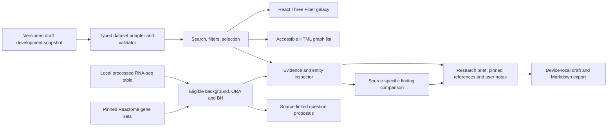
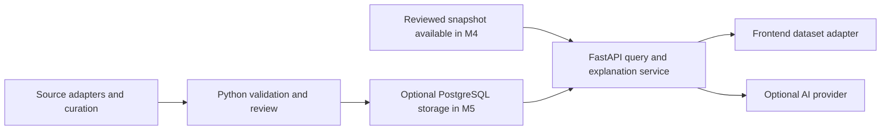

# Architecture

Status: the 40-entity **Source-checked draft** explorer is implemented; the owner reports a working Vercel deployment. Independent scientific review is deferred to a future milestone and does not block development work. See [product scope](product.md), [build steps](../steps.md), [checkpoints](checkpoints.md), and [dataset notes](../data/alzheimers/README.md).

The primary product workflow now interprets processed human RNA-seq results. Its separate analysis reference and uploaded observations do not expand or modify the curated scientific snapshot.

## Current static explorer

The application uses React 19.3.0, TypeScript 5.9.3, Vite 8.3.2, Three.js 0.186.1, and React Three Fiber 9.8.1. Native Three.js `OrbitControls` provides camera navigation; Drei is not installed. The root npm workspace manages `apps/web/` with an exact-version lockfile, Node 24, and npm 11.9.0. See the [dependency security policy](npm-security.md) before installing or updating packages.

The client imports snapshot `alzheimers-source-checked-0.7.0`: one disease, fourteen genes, fourteen distinct proteins, three pathways and eight papers. Its 41 claims/evidence records combine four original association findings with canonical gene/product mappings, curated pathway participation, TREM2–DAP12 binding, five assay-scoped APOE–TREM2 findings from three original papers, and two Cheng 2021 domain/modified-apoB binding findings. Source locators and context distinguish experimental studies from database assertions. All records remain draft; source-specific checks and unknowns are preserved. [Dataset changes](../data/alzheimers/CHANGELOG.md) record the inspected material and provenance.

Implemented views share React state for alias-aware search, all current entity-type filters, entity/claim selection and evidence inspection. The scene loads lazily. The inspector distinguishes **Original paper** from **Database annotation**, links the original title directly and lets users follow a claim's other entity without losing the finding or graph/list mode. Two-finding comparison exports a cited Markdown brief. The research brief workspace combines pinned references with user-authored reasoning, device-local saving and a cited document export. The client requires no backend, database, live scientific API, or AI credential. One draft study-context comparison records differing R47H reports; definitive disagreement classifications, curator-reviewed research-question cards and live AI explanations remain planned.

Binding comparison defaults use exact recorded condition labels and distinct publication identities as navigation hints; they never infer agreement or independence. Explicit experimental-system context selects an assay-first row order without dropping missing fields. A shared publication-status component retains recorded notice dates and original links in both the inspector and comparison; the Markdown brief retains notice URLs as well.



The diagram shows the current application. The galaxy, list, and inspector are views of the same local records. A structural validation pass permits development use; it does not establish scientific validity. See the [data model](data-model.md) for schema `0.1.0` and the [evidence policy](evidence-policy.md) for publication rules.

## Component boundaries

Database expansion uses an offline curation boundary: `biomedical-intake.ts` builds fixed UniProt/Reactome/Open Targets requests, normalizes allowlisted facts and writes source-linked staging packets. It never runs in the browser, reads experiments or promotes scientific records. The bounded [reference seed](../data/annotations/README.md) is reproducible from existing HGNC/Reactome bytes and explicitly distinct from API retrieval. Live provider access is blocked in the current cloud workspace; archived/simulated-response checks are separate from a successful live integration. A separate source-checked snapshot diff is required to display facts in the explorer.

| Boundary | Responsibility |
| --- | --- |
| Dataset adapter | Validate the imported snapshot and expose typed entities, claims, evidence, and sources. Invalid data produces a load-error state. |
| Search and graph helpers | Normalize aliases and identifiers; derive linked claims, paper citations, and filtered results without changing source records. |
| Explorer state | Own query, selected identifiers, active filters, and view mode; keep the canvas and HTML views synchronized. |
| Galaxy scene | Render nodes, edges, labels, camera focus, and visible selection state. Keep scientific logic outside render components. |
| Evidence inspector | Present the selected draft claim, source-linked notes, study context, limitations, original references, and review status. |
| Finding comparison | Align two findings' recorded context and preserve source-specific values, limitations, review fields, and publication identities in the view and Markdown brief. |
| Sharing | Capture the graph on demand, generate a cited PNG in the browser, and encode validated explorer state in a shareable URL fragment. |
| Research brief | Own bounded user notes and claim references separately from scientific records; save locally and export complete cited evidence. |
| Experimental analysis | Parse local results, declare eligible background, calculate source-specific membership overrepresentation and present measurements/questions without changing the graph. |

The development snapshot meets M2's 20–50 entity size target and includes typed pathway journeys. Experimental analysis and user-authored research briefs are separate working tools; further source expansion and independent scientific review remain future work. M3 adds justified disagreement comparisons and curator-reviewed research-question cards, separate from evidence-backed claims and without invented consensus scores.

At this size, local indexes and a bounded graph traversal are sufficient. A graph database, distributed processing, and microservices add little value before the exploration flow works. The adapter allows a future HTTP source to replace the local loader without coupling the UI to an upstream provider's response shape.

## Layout and interaction

The [design guide](design.md) is the standing interface standard. The interface uses a single control set above the explorer, a graph/list workspace, and a readable evidence panel. Light or dark neutral interface surfaces frame the dark graph. Copy names actions and information directly. Observed browser results are recorded in the [verification record](verification.md).

- `WorkspaceHelp` provides separate native dialogs beside the workspace controls. Opening one preserves the active workspace and all pending/applied input, does not load the analysis module/reference and retains native focus containment, Escape and trigger return. Copy and examples describe the existing workflows rather than adding a second analysis entry point.
- Search, type filtering and Graph/List share one toolbar. Filtered views show actual match/related counts and a clear action; the unfiltered count remains available to screen readers without another visual toolbar. The inspector groups its icon and title, with names/identifiers in **Entity details** and summaries in **Study details and limitations**. The graph legend appears with the graph only.
- `source-format.ts` owns author/citation labels shared by the inspector, comparison and study-context note. Data and export logic remain separate from presentation; removing helper text does not rewrite scientific records or sharing output.
- `explorer-graph.ts` derives focused one-hop neighbourhoods, one optional extra level and a complete overview with selection-only edges. Display edges deduplicate endpoint pairs while retaining the active claim; no scientific records merge. Paper nodes/citations are explicit search/filter/selection destinations rather than automatic clutter. Bounded (24-entry) Back history restores selection, claim, search, filter and graph scope in tab memory.
- `createFocusedLayout` centers the selected entity and uses deterministic inner/outer navigation rings, preserving first-ring positions during expansion. `createGalaxyLayout` derives deterministic type-based overview/search rings from the full snapshot, preserving those positions when the visible set changes. Papers use two outer arcs that leave room for horizontal pathway/protein labels as the collection grows. Position, size, glow, and decorative stars are navigation choices, not measurements of biological similarity, causality, or evidence strength. Narrow views prioritize the main anchors and current selection; labels wrap and stay within the canvas where possible.
- Solid connections project claims; dashed connections connect paper projections to the claims they cite. Citation links are not additional biological relationships.
- The HTML list, search results, and inspector provide entity and evidence selection without manipulating the canvas. The scene itself is hidden from the accessibility tree.
- Focus/expansion positions interpolate together with their edge endpoints; camera fit uses the target bounds. Overview/expansion/history are transient navigation state, not additional shared-link fields; existing links reopen the selected entity/finding with their recorded query/filter/view. The PNG still captures the actual camera view.
- The renderer uses demand-based frames, bounded pixel density, camera reset, and reduced-motion-aware controls. Hover, selection, camera focus, and zoom animate briefly and settle; materials and geometry are reused during feedback. User gestures interrupt camera transitions. Renderer errors and lost WebGL context switch to the list view.
- Filters expose their active state and support clearing. An absent edge in the curated or filtered graph says nothing about whether a relationship exists in the wider literature.
- Following **View …** keeps the current claim, clears filters that would hide the target, preserves graph/list mode and focuses the target's heading without scrolling the document. Labels retain direction: a protein is **Encoded by** its gene; a pathway lists a **Participant**.

The graph/list/evidence flows and presentation refinements have browser coverage. Future refinements still need their own browser QA; do not infer their usability or smoothness from a passing build. Keyboard interaction, reduced-motion behavior, and fallback checks must be recorded separately from build and unit-test results.

## Experimental-data interpretation

`ExperimentWorkspace` loads lazily behind **Analyze results** and stays mounted while users inspect covered genes in **Explore**. Pending file/form values are separate from applied results; read/reference failures preserve the last successful analysis. A layout effect focuses committed results only after the DOM exists and only when the workspace is visible. Shared entity links return to Explore; workspace skip links do not reset selection. Data is held in memory, excluded from localStorage, URLs and image/brief exports, and dropped on reload.

`experiment.ts` parses bounded CSV/TSV, including quoted cells, BOM and common header aliases. It preserves exact human-style symbol spelling or human Ensembl IDs, null statistics and all accepted rows; duplicate/unsupported IDs or malformed values fail with row/column errors. Ambiguous/unrecognized identifier columns request an explicit column choice; an unnamed first R row-name column is supported. Syntax does not verify HGNC identity or species. The input contains already-computed gene log2FC/padj, not raw counts or a differential-expression pipeline.

`gene-identifiers.ts` validates a separate pinned HGNC asset, resolves exact Ensembl cross-references and preserves original/versioned IDs. Ambiguous/unmapped identities remain unannotated after explicit acknowledgement; duplicate stable or resolved gene identities block analysis. Its report is searchable/paginated in `GeneMappingDetails`; metadata stays accessible after applying results. The reference loads only for explicit Ensembl analysis.

`experiment-analysis.ts` requires a named numerator/denominator contrast and full-tested-table declaration. Background eligibility requires complete log2FC and padj before p/effect cutoffs; incomplete rows remain in the input and are reported separately. Eligible unannotated genes stay in N. `enrichment.ts` calculates right-tailed hypergeometric probabilities in log space and applies BH across all pathways with eligible members, including zero hits. No gene-level adjustment is recomputed. Numeric underflow retains finite log probabilities; a reported input zero is not assigned invented precision.

The [Reactome reference](../data/reference/README.md) is a separate local asset fetched only when analysis is requested. It contains 2,751 pathway sets with pinned mirror commit/raw digest and a checked normalized digest; exact upstream release remains unknown. Original descriptive/viral member labels remain literal and cannot become guessed human aliases. `npm run reference:check` verifies the prepared bytes without network; native analysis tests also check the full digest. No live provider or credential is required.

Results show eligible/selected/mapped denominators, the complete tested family, paginated pathway/member tables and signed transcript measurements. Gene and pathway FDR are distinct. A matched gene's **Your RNA-seq result** is separate from its literature findings; protein nodes receive no RNA measurement. `buildExperimentQuestions` uses the selected input and pathway membership, optionally retaining the original APOE/TREM2 assay comparison and its limits. Proposals stay outside the graph's `Hypothesis` collection and do not establish novelty, activity or a causal mechanism. Pooled directions, overlapping pathways and gene-length/expression selection bias are disclosed in methods.

The optional experiment context is normalized by `experiment-context.ts` and copied into an applied analysis. `ExperimentContextDetails` presents the same captured values in Methods and the gene observation. The form retains pending edits until apply succeeds and clears its context for a replacement file/removal. Explicit observational versus perturbation design chooses a follow-up template; tissue/model and condition scope it without modifying numerical analysis, reference membership or cited-study metadata. The example supplies explicitly synthetic context. No context is sent to the numerical worker, saved automatically or included in existing sharing/brief exports.

`pathway-evidence.ts` derives a read-only coverage report from the applied pathway's overlap genes and the validated snapshot. It uses exact gene labels plus one explicitly supported `encodes` step to proteins, with no propagation through interaction or pathway neighbours. Publication findings group by source ID (publication identities are unique in a validated snapshot); database-only records do not count as papers. A finding shared by several selected genes and repeated evidence from a paper appears once with its original records. Context notes require all their named claims/evidence. `PathwayEvidence` displays a paginated selected-gene audit, paper disclosures, source notices and links to the existing inspector, where full context/limits remain available. Its state resets on pathway/applied-analysis replacement and remains mounted while the user visits a finding. This feature adds no network request, input storage, scientific claim or numerical-analysis dependency.

## Finding comparison

`buildEvidenceComparison` derives two columns from existing claim, evidence, and source records. Claim scope remains separate from each source's study context. Aligned rows retain unknowns and extra context fields, including participant subsets, without summing samples or filling absent study fields from a claim summary. Labels compare exact recorded values; they do not classify biological agreement, contradiction, comparability, independence, or strength.

Shared source IDs, normalized PMIDs, and DOIs identify repeated citation identities. No detected identity overlap does not establish independent cohorts. Reading prompts are deterministic source checks derived from missing or different context. They are not a hypothesis-generation service, verified research gaps, or curator-approved disagreement records.

The native comparison dialog preserves the underlying explorer state. Its Markdown export contains the selected statements, full claim and study context, source links and locators, limitations, actual review/reuse/publication fields, and dataset version. It performs no network request and changes no scientific record.

Table cells omit repeated attribution when one evidence record and the column heading already identify the value. Multiple records and differing claim scope retain explicit labels. Matching-field status stays available to screen readers; different and missing context remain visible. General interpretation and source-identity checks use one disclosure below the table.

`StudyContextNote` renders only annotations from the snapshot's `conflicts` collection, after a finding's original citation and between the comparison cards and context table. It retains both original links, methodological differences and actual check metadata. Comparison includes a note only when all its claims and cited evidence belong to the selected pair; the complete note and provenance remain in the Markdown brief. The initial partner prefers an explicit curated pair before the recorded-condition fallback. No note is inferred from automatic field differences.

## Research brief workspace

`research-brief.ts` owns a bounded, versioned user-draft contract, explicit pin/comparison actions and Markdown assembly. It stores claim IDs rather than copied scientific records, never mutates the snapshot and never creates a `Hypothesis` or review attestation. Including a comparison pins both findings atomically. Removing either pin clears its comparison while preserving notes. `source-format.ts` shares finding labels across the inspector, comparison and brief.

`useResearchBrief` restores one draft from `discovery-galaxy:research-brief:v1` in `localStorage`, validates its shape and debounces writes by 300 ms, flushing the latest edit on `pagehide` for an immediate refresh. Storage failures preserve an in-memory draft. Unreadable data and another tab's change pause automatic writes; only **Save this version** replaces the stored draft. Before writing, the hook also checks that the saved value has not changed. This prevents ordinary tab overwrites; localStorage is not an atomic collaborative store, a backup or cloud sync.

Dataset-version mismatches keep the user's notes and referenced IDs. The workspace identifies unavailable findings, shows that evidence resolves against the current snapshot and requires explicit **Refresh evidence** before adding findings/comparisons or exporting. Unavailable references must be removed first. A refresh acknowledges the current snapshot; it does not claim to have rechecked the original literature or archive the old scientific records.

`ResearchBrief` provides labeled native textareas, pinned citations/disclosures and optional pair selectors. Writing precedes evidence in document order; desktop shows them side by side and mobile stacks them. Sticky download/save feedback remains available while scrolling. **View finding** clears hiding filters, keeps graph/list mode and explicitly focuses/scrolls to the inspector. Ordinary closing returns focus to the brief trigger.

`buildResearchBrief` requires a question and resolvable pinned evidence from the current snapshot. User notes are escaped and blockquoted in their own sections. The shared complete finding renderer and existing comparison exporter retain scientific statements, contexts, locators, source/notice URLs, unknowns and actual review metadata. An included comparison keeps its curated context note. The exported document labels user reasoning as a draft and does not attest novelty, feasibility or support for that reasoning. Downloads use a local Blob; notes are never included in explorer links or PNG exports and are not uploaded.

## Threshold sensitivity and overlap groups

`experiment-robustness.ts` owns pure computations over an already applied analysis. Sensitivity preserves resolved observations, eligible N and the complete pathway family across at most nine distinct cutoff settings; each has a separately calculated pathway BH. The exact applied result is reused without mutation. Counts are descriptive; the grid is not jointly corrected across settings or a confidence estimate. `ThresholdSensitivity` displays a pathway-specific matrix, the applied cell and optional counts/method details.

Grouping uses all eligible pathway members, including genes outside the selected set. A greedy algorithm visits pathways by ascending applied log-BH, log-p and ID, assigns to the most similar existing representative at Jaccard ≥0.5, and resolves ties by representative order. An inverted gene index avoids unrelated comparisons. Members never become new representatives within their group, preventing transitive-chain collapse. Groups preserve all original results, with no pooled statistic or new testing family. Filtered search can show an original representative with matching members; pagination counts groups and pathways separately.

`useExperimentRobustness` starts the bundled module worker only when requested, shares it between operations for one applied analysis, caches successful reports and reports recoverable errors without replacing the input. It terminates the worker and releases old owner state on result replacement/removal; replies from an old worker cannot repopulate the UI. Calculations and message payloads stay in this tab. Workers make no data request and write no storage. Existing graph/list/evidence flows remain mounted and usable.

## Sharing

Image export captures the current graph on demand and combines it with the selected entity, full finding, source references, dataset version, and explicit draft status. The image renderer uses local Canvas APIs; it does not fetch paper content or upload the image. List view and unavailable WebGL use an evidence card without pretending to capture a graph. Native file sharing is optional; PNG download remains available.

Shared links encode entity and claim IDs, query, type filter, and Graph/List view in a URL fragment. Parsing validates those values against the current snapshot, so missing or obsolete records fall back safely. Camera orbit and zoom are not serialized. Copied links omit unrelated query parameters; they are references to the current dataset, not immutable copies of the scientific record. The PNG carries its dataset version for that distinction.

## Data preparation

The dataset is prepared through explicit source inspection and a versioned manual diff, checked by the TypeScript validator used by the client and CLI. Development validation checks structure, references, provenance fields and claim/evidence consistency. The separate future scientific-release gate retains approved-review, reuse, publication-status and size requirements. The current source-checked draft deliberately does not claim those approvals.

The offline `tools/curation/review-packet.ts` reads that snapshot through the same validator and renders a deterministic Markdown review extract. It preserves claim and source-specific study context, original citations, limitations, and actual review/reuse/publication-status fields. `npm run curation:check` detects a stale committed packet. The generator makes no network requests, changes no scientific records, and creates no review attestations.

Introduce Python and NetworkX curation tooling in M2 for normalization, bounded graph inspection, and reproducible exports. The existing Python IOC checker is dependency-security tooling, not a scientific import pipeline. NetworkX connectivity will not establish a biological mechanism or validate a hypothesis.

`tools/curation/openalex-intake.ts` is the first candidate-source adapter. It requests one bounded page of selected OpenAlex metadata fields or normalizes an explicitly supplied archived response. Its allowlist excludes abstracts, full text, and unrelated payload fields. The output retains query/retrieval provenance, canonical publication identifiers, and provider flags; records stay unreviewed and outside the graph. A provider retraction flag is not an independent correction/retraction check. The live API has no immutable release identifier, and an offline input must not be described as a verified live lookup. Current access requirements and observed checks are documented in [curation tooling](../tools/curation/README.md) and [verification](verification.md).

The separate bounded UniProt/Reactome/Open Targets adapters now stage database annotations with archived replay, byte digests and actual/offline request provenance. They do not promote claims, transmit user experiments or establish a successful live integration in this network-restricted workspace. A source-checked draft requires a separately inspected dataset diff; the future scientific release retains its actual review/reuse gates. Preserve source identifiers, reported releases, retrieval limits and score definitions.

The client makes no upstream scientific API requests. The checked-in snapshot makes local exploration reproducible and independent of those services; opening an original external reference still requires network access.

Future dataset work remains AD-focused. Candidate collection, source comparison, human review, and versioned publication are separate stages; intake can automate metadata collection and normalization without promoting candidates or recording human approval. Apply the workflow to another disease only after the AD evidence journey is reliable. This is separate from the current brief workspace; see [future content work](checkpoints.md#future-content-work-deepen-the-alzheimers-evidence).

## Later services, when needed



This is a later extension, not a prerequisite for the initial client. Add FastAPI when the application needs server-managed explanations, dynamic queries, or controlled refreshes; the optional M4 explanation service can read the reviewed snapshot without PostgreSQL. Add PostgreSQL when reviewed updates, record history, or query volume outgrow a static artifact. Store entities, claims, evidence, sources, and their provenance separately; relational joins are a reasonable starting point.

For optional AI, retrieve a bounded set of reviewed claim and evidence records on the server. Return citations that resolve to those supplied records. Explicitly separate evidence summaries from speculative questions and abstain when the available evidence cannot answer a request. Model output is not a new scientific source and must not silently alter the curated graph. Prompting alone does not guarantee factual accuracy: check citation references, evaluate grounding, and retain a curated-summary fallback.

Keep provider keys on the server, outside version control and client bundles. Add timeouts, request size limits, rate limits, and an explicit error state when this service exists. Core graph exploration must remain usable when explanations are unavailable.

## Repository layout

Current implementation paths:

```text
apps/web/             React app, scene, HTML views, adapter, validator, tests
data/alzheimers/       Draft development snapshot and source-lookup notes
data/schema/          Knowledge-graph JSON Schema
tools/validate-data.ts Development and release-mode data validation CLI
tools/curation/        AD review-packet generator, OpenAlex candidate intake, and tests
tools/security/       Lockfile policy, known-IOC checker, pinned feed manifest
```

Reviewed scientific import/promotion and `services/api/` remain planned. No backend, PostgreSQL instance, or AI service exists. The checked-in dependency policy records a 14-day resolution cutoff; `.npmrc` disables installation lifecycle scripts, and the lockfile checker verifies source URLs, integrity hashes, and direct version pins. These controls reduce exposure without certifying dependencies as malware-free.

## Validation boundaries

Run the root project commands documented in [CONTRIBUTING.md](../CONTRIBUTING.md):

- `npm run validate:data` checks the development snapshot; warnings retain its pending-review status.
- `npm run validate:release` exercises the stricter publication gate and must fail for the current draft snapshot.
- `npm test` covers data integrity, release gates, alias search, paper-to-claim lookup, source-specific comparison, research-brief state/export boundaries, and curation tooling using isolated synthetic fixtures and the checked-in starter.
- `npm run build` runs TypeScript checks before creating the production bundle.
- `npm run check:dependencies` checks the lockfile's sources, integrity, and pins. Network-backed publication-date and pinned IOC checks are described in the [security policy](npm-security.md).

Browser QA must exercise search → entity → claim → original reference through both views, plus keyboard access, no results, reduced motion, and renderer fallback. Automated data tests do not verify those interactions. Measure responsiveness on a documented device/browser before setting or reporting a performance budget.

Comparison checks must distinguish variant contexts, keep source-specific missing fields and participant subsets separate, retain cited brief content, and preserve keyboard/mobile access. Intake checks must distinguish offline normalization from live retrieval and keep metadata candidates outside the scientific snapshot.

Brief checks must preserve user text and references across reloads, keep exports cited without laundering notes into findings, and exercise blocked/corrupt storage, dataset changes and conflicting tabs through the browser. Model tests alone do not verify the autosave hook or dialog focus.

When AI is introduced, evaluate citation validity, claim grounding, abstention, hypothesis labeling, and service failure using reviewed answerable and unanswerable cases.

Keep tests proportional to real failure modes. Dataset provenance and the user's evidence-reading journey matter more than snapshotting decorative scene details.
