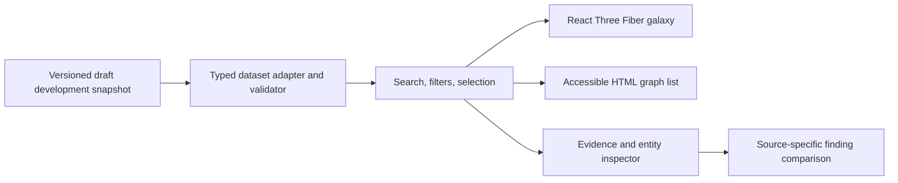
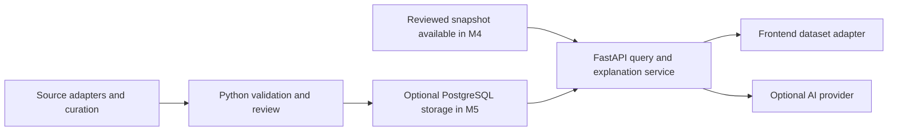

# Architecture

Status: the 24-entity **Source-checked draft** explorer is implemented; the owner reports a working Vercel deployment. Independent scientific review is deferred to a future milestone and does not block development work. See [product scope](product.md), [build steps](../steps.md), [checkpoints](checkpoints.md), and [dataset notes](../data/alzheimers/README.md).

## Current static explorer

The application uses React 19.3.0, TypeScript 5.9.3, Vite 8.3.2, Three.js 0.186.1, and React Three Fiber 9.8.1. Native Three.js `OrbitControls` provides camera navigation; Drei is not installed. The root npm workspace manages `apps/web/` with an exact-version lockfile, Node 24, and npm 11.9.0. See the [dependency security policy](npm-security.md) before installing or updating packages.

The client imports snapshot `alzheimers-source-checked-0.5.0`: one disease, seven genes, seven distinct proteins, two pathways and seven papers. Its 24 claims/evidence records combine four original association findings with canonical gene/product mappings, curated pathway participation, TREM2–DAP12 binding and five assay-scoped APOE–TREM2 findings from three original papers. Source locators and context distinguish experimental studies from database assertions. All records remain draft; source-specific checks and unknowns are preserved. [Dataset changes](../data/alzheimers/CHANGELOG.md) record the inspected material and provenance.

Implemented views share React state for alias-aware search, all current entity-type filters, entity/claim selection and evidence inspection. The scene loads lazily. The inspector distinguishes **Original paper / Open paper** from **Database annotation / Open record** and lets users follow a claim's other entity without losing the finding or graph/list mode. Two-finding comparison exports a cited Markdown brief. The client requires no backend, database, live scientific API, or AI credential. One draft study-context comparison records differing R47H reports; definitive disagreement classifications, research-question cards and live AI explanations remain planned.

Binding comparison defaults use exact recorded condition labels and distinct publication identities as navigation hints; they never infer agreement or independence. Explicit experimental-system context selects an assay-first row order without dropping missing fields. A shared publication-status component retains recorded notice dates and original links in both the inspector and comparison; the Markdown brief retains notice URLs as well.



The diagram shows the current application. The galaxy, list, and inspector are views of the same local records. A structural validation pass permits development use; it does not establish scientific validity. See the [data model](data-model.md) for schema `0.1.0` and the [evidence policy](evidence-policy.md) for publication rules.

## Component boundaries

| Boundary | Responsibility |
| --- | --- |
| Dataset adapter | Validate the imported snapshot and expose typed entities, claims, evidence, and sources. Invalid data produces a load-error state. |
| Search and graph helpers | Normalize aliases and identifiers; derive linked claims, paper citations, and filtered results without changing source records. |
| Explorer state | Own query, selected identifiers, active filters, and view mode; keep the canvas and HTML views synchronized. |
| Galaxy scene | Render nodes, edges, labels, camera focus, and visible selection state. Keep scientific logic outside render components. |
| Evidence inspector | Present the selected draft claim, source-linked notes, study context, limitations, original references, and review status. |
| Finding comparison | Align two findings' recorded context and preserve source-specific values, limitations, review fields, and publication identities in the view and Markdown brief. |
| Sharing | Capture the graph on demand, generate a cited PNG in the browser, and encode validated explorer state in a shareable URL fragment. |

The development snapshot meets M2's 20–50 entity size target and includes typed pathway journeys. Further work deepens original-study evidence and source provenance; independent scientific review is a future milestone. M3 adds justified disagreement comparisons and research-question cards, separate from evidence-backed claims and without invented consensus scores.

At this size, local indexes and a bounded graph traversal are sufficient. A graph database, distributed processing, and microservices add little value before the exploration flow works. The adapter allows a future HTTP source to replace the local loader without coupling the UI to an upstream provider's response shape.

## Layout and interaction

The [design guide](design.md) is the standing interface standard. The interface uses a single control set above the explorer, a graph/list workspace, and a readable evidence panel. Light or dark neutral interface surfaces frame the dark graph. Copy names actions and information directly. Observed browser results are recorded in the [verification record](verification.md).

- `createGalaxyLayout` derives deterministic type-based rings from the full snapshot, preserving positions when the visible set changes. Papers use two outer arcs that leave room for horizontal pathway/protein labels as the collection grows. Position, size, glow, and decorative stars are navigation choices, not measurements of biological similarity, causality, or evidence strength. Narrow views prioritize the main anchors and current selection; labels wrap and stay within the canvas where possible.
- Solid connections project claims; dashed connections connect paper projections to the claims they cite. Citation links are not additional biological relationships.
- The HTML list, search results, and inspector provide entity and evidence selection without manipulating the canvas. The scene itself is hidden from the accessibility tree.
- The renderer uses demand-based frames, bounded pixel density, camera reset, and reduced-motion-aware controls. Hover, selection, camera focus, and zoom animate briefly and settle; materials and geometry are reused during feedback. User gestures interrupt camera transitions. Renderer errors and lost WebGL context switch to the list view.
- Filters expose their active state and support clearing. An absent edge in the curated or filtered graph says nothing about whether a relationship exists in the wider literature.
- Following **View …** keeps the current claim, clears filters that would hide the target, preserves graph/list mode and focuses the target's heading without scrolling the document. Labels retain direction: a protein is **Encoded by** its gene; a pathway lists a **Participant**.

The graph/list/evidence flows and presentation refinements have browser coverage. Future refinements still need their own browser QA; do not infer their usability or smoothness from a passing build. Keyboard interaction, reduced-motion behavior, and fallback checks must be recorded separately from build and unit-test results.

## Finding comparison

`buildEvidenceComparison` derives two columns from existing claim, evidence, and source records. Claim scope remains separate from each source's study context. Aligned rows retain unknowns and extra context fields, including participant subsets, without summing samples or filling absent study fields from a claim summary. Labels compare exact recorded values; they do not classify biological agreement, contradiction, comparability, independence, or strength.

Shared source IDs, normalized PMIDs, and DOIs identify repeated citation identities. No detected identity overlap does not establish independent cohorts. Reading prompts are deterministic source checks derived from missing or different context. They are not a hypothesis-generation service, verified research gaps, or curator-approved disagreement records.

The native comparison dialog preserves the underlying explorer state. Its Markdown export contains the selected statements, full claim and study context, source links and locators, limitations, actual review/reuse/publication fields, and dataset version. It performs no network request and changes no scientific record.

`StudyContextNote` renders only annotations from the snapshot's `conflicts` collection, after a finding's original citation and between the comparison cards and context table. It retains both original links, methodological differences and actual check metadata. Comparison includes a note only when all its claims and cited evidence belong to the selected pair; the complete note and provenance remain in the Markdown brief. The initial partner prefers an explicit curated pair before the recorded-condition fallback. No note is inferred from automatic field differences.

## Sharing

Image export captures the current graph on demand and combines it with the selected entity, full finding, source references, dataset version, and explicit draft status. The image renderer uses local Canvas APIs; it does not fetch paper content or upload the image. List view and unavailable WebGL use an evidence card without pretending to capture a graph. Native file sharing is optional; PNG download remains available.

Shared links encode entity and claim IDs, query, type filter, and Graph/List view in a URL fragment. Parsing validates those values against the current snapshot, so missing or obsolete records fall back safely. Camera orbit and zoom are not serialized. Copied links omit unrelated query parameters; they are references to the current dataset, not immutable copies of the scientific record. The PNG carries its dataset version for that distinction.

## Data preparation

The dataset is prepared through explicit source inspection and a versioned manual diff, checked by the TypeScript validator used by the client and CLI. Development validation checks structure, references, provenance fields and claim/evidence consistency. The separate future scientific-release gate retains approved-review, reuse, publication-status and size requirements. The current source-checked draft deliberately does not claim those approvals.

The offline `tools/curation/review-packet.ts` reads that snapshot through the same validator and renders a deterministic Markdown review extract. It preserves claim and source-specific study context, original citations, limitations, and actual review/reuse/publication-status fields. `npm run curation:check` detects a stale committed packet. The generator makes no network requests, changes no scientific records, and creates no review attestations.

Introduce Python and NetworkX curation tooling in M2 for normalization, bounded graph inspection, and reproducible exports. The existing Python IOC checker is dependency-security tooling, not a scientific import pipeline. NetworkX connectivity will not establish a biological mechanism or validate a hypothesis.

`tools/curation/openalex-intake.ts` is the first candidate-source adapter. It requests one bounded page of selected OpenAlex metadata fields or normalizes an explicitly supplied archived response. Its allowlist excludes abstracts, full text, and unrelated payload fields. The output retains query/retrieval provenance, canonical publication identifiers, and provider flags; records stay unreviewed and outside the graph. A provider retraction flag is not an independent correction/retraction check. The live API has no immutable release identifier, and an offline input must not be described as a verified live lookup. Current access requirements and observed checks are documented in [curation tooling](../tools/curation/README.md) and [verification](verification.md).

Open Targets and Reactome adapters remain planned. Import only reviewed records into a published scientific snapshot. Preserve upstream identifiers, release information, retrieval dates, and applicable attribution and redistribution terms. Verify current upstream API access and licensing before implementing each adapter.

The client makes no upstream scientific API requests. The checked-in snapshot makes local exploration reproducible and independent of those services; opening an original external reference still requires network access.

The next dataset pass remains AD-focused. Candidate collection, source comparison, human review, and versioned publication are separate stages; intake can automate metadata collection and normalization without promoting candidates or recording human approval. Apply the workflow to another disease only after the AD evidence journey is reliable. The bounded next deliverable is described in [checkpoints](checkpoints.md#next-checkpoint-deepen-the-alzheimers-evidence).

## Later services, when needed



This is a later extension, not a prerequisite for the initial client. Add FastAPI when the application needs server-managed explanations, dynamic queries, or controlled refreshes; the optional M4 explanation service can read the reviewed snapshot without PostgreSQL. Add PostgreSQL when reviewed updates, record history, or query volume outgrow a static artifact. Store entities, claims, evidence, sources, and their provenance separately; relational joins are a reasonable starting point.

For optional AI, retrieve a bounded set of reviewed claim and evidence records on the server. Return citations that resolve to those supplied records. Explicitly separate evidence summaries from speculative questions and abstain when the available evidence cannot answer a request. Model output is not a new scientific source and must not silently alter the curated graph. Prompting alone does not guarantee factual accuracy: check citation references, evaluate grounding, and retain a curated-summary fallback.

Keep provider keys on the server, outside version control and client bundles. Add timeouts, request size limits, rate limits, and an explicit error state when this service exists. Core graph exploration must remain usable when explanations are unavailable.

## Repository layout

Current implementation paths:

```text
apps/web/             React app, scene, HTML views, adapter, validator, tests
data/alzheimers/       Draft development snapshot and source-lookup notes
data/schema/          Knowledge-graph JSON Schema
tools/validate-data.ts Development and release-mode data validation CLI
tools/curation/        AD review-packet generator, OpenAlex candidate intake, and tests
tools/security/       Lockfile policy, known-IOC checker, pinned feed manifest
```

Reviewed scientific import/promotion and `services/api/` remain planned. No backend, PostgreSQL instance, or AI service exists. The checked-in dependency policy records a 14-day resolution cutoff; `.npmrc` disables installation lifecycle scripts, and the lockfile checker verifies source URLs, integrity hashes, and direct version pins. These controls reduce exposure without certifying dependencies as malware-free.

## Validation boundaries

Run the root project commands documented in [CONTRIBUTING.md](../CONTRIBUTING.md):

- `npm run validate:data` checks the development snapshot; warnings retain its pending-review status.
- `npm run validate:release` exercises the stricter publication gate and must fail for the current draft snapshot.
- `npm test` covers data integrity, release gates, alias search, paper-to-claim lookup, source-specific comparison, and curation tooling using isolated synthetic fixtures and the checked-in starter.
- `npm run build` runs TypeScript checks before creating the production bundle.
- `npm run check:dependencies` checks the lockfile's sources, integrity, and pins. Network-backed publication-date and pinned IOC checks are described in the [security policy](npm-security.md).

Browser QA must exercise search → entity → claim → original reference through both views, plus keyboard access, no results, reduced motion, and renderer fallback. Automated data tests do not verify those interactions. Measure responsiveness on a documented device/browser before setting or reporting a performance budget.

Comparison checks must distinguish variant contexts, keep source-specific missing fields and participant subsets separate, retain cited brief content, and preserve keyboard/mobile access. Intake checks must distinguish offline normalization from live retrieval and keep metadata candidates outside the scientific snapshot.

When AI is introduced, evaluate citation validity, claim grounding, abstention, hypothesis labeling, and service failure using reviewed answerable and unanswerable cases.

Keep tests proportional to real failure modes. Dataset provenance and the user's evidence-reading journey matter more than snapshotting decorative scene details.
