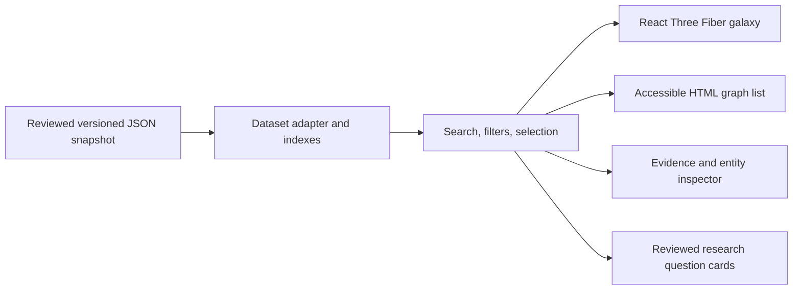
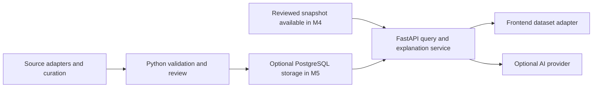

# Architecture

Status: design only. The repository currently contains project documentation; the application, dataset, validation tools, and services described here have not been implemented. See the [product scope](product.md) and [build steps](../steps.md).

## Static explorer (M1–M3)

Build a React and TypeScript application with Vite. Use Three.js through React Three Fiber for the galaxy and Drei where it simplifies camera controls or labels. Keep graph selection, search, filters, and evidence inspection in ordinary React state shared with an accessible HTML view.

M1 loads a small reviewed, versioned JSON starter snapshot; M2 expands it to the 20–50 entity MVP target and adds filters. M3 adds reviewed disagreement comparisons and research questions. The static explorer needs no backend, database, external data API, or AI credential to run. Search includes canonical names and curated aliases. Selecting an entity exposes its relationships; selecting a relationship exposes the claim, supporting and challenging evidence, study context, and original references.



The diagram shows the static explorer through M3, not everything required in M1. The snapshot is the scientific source of truth for this version. The galaxy, list, inspector, and question cards are views of the same records. See the [data model](data-model.md) for the contract and [evidence policy](evidence-policy.md) for publication rules.

## Component boundaries

| Boundary | Responsibility |
| --- | --- |
| Dataset adapter | Load a specific snapshot, check its schema version, and expose entities, claims, evidence, sources, and questions through stable application types. |
| Search and graph indexes | Resolve identifiers and aliases; derive adjacency and filter results without changing source records. |
| Explorer state | Own query, selected identifiers, active filters, and view mode; keep the canvas and HTML views synchronized. |
| Galaxy scene | Render nodes, edges, labels, camera focus, and visible selection state. Keep scientific logic outside render components. |
| Evidence inspector | Explain the selected claim with citations and relevant study context. Display curated disagreement without inventing a consensus score. |
| Question cards | Display reviewed, explicitly labeled hypotheses with their motivating evidence and limitations. They are separate from established graph claims. |

At this size, local indexes and a bounded graph traversal are sufficient. A graph database, distributed processing, and microservices add little value before the exploration flow works. The adapter allows a future HTTP source to replace the local loader without coupling the UI to an upstream provider's response shape.

## Layout and interaction

- Use a deterministic layout or saved positions so a given dataset remains recognizable across visits. A force layout may improve readability, but node distance, brightness, and centrality must not imply biological similarity, causality, or evidential strength without an explicit, documented mapping.
- Treat edges as claims with predicates and evidence, not generic similarity lines. Any directional arrows must follow the recorded relationship semantics.
- Provide an HTML list and inspector with keyboard navigation, visible focus, text labels, and entity-type labels that do not rely only on color. All evidence must be reachable without manipulating a 3D camera.
- Respect reduced-motion preferences, provide camera reset, and bound animation work. Use the HTML exploration view if WebGL is unavailable or rendering fails.
- Keep filtering effects visible. An absent edge in a filtered or curated snapshot says nothing about whether the relationship exists in the wider literature.

## Data preparation

Introduce Python and NetworkX tooling in M2 for normalization, reference checks, bounded graph inspection, and reproducible exports. M1 curation can be manual, supported by the initial minimal validator. NetworkX is an analysis tool; connectivity does not establish a biological mechanism or validate a hypothesis.

Adapters for Open Targets, Reactome, and OpenAlex belong in this preparation boundary. Import only reviewed records into the published snapshot. Preserve upstream identifiers, release information, retrieval dates, and applicable attribution and redistribution terms. Verify current upstream API access and licensing before implementing an adapter; this document does not establish either.

Do not call upstream scientific services from the rendering loop. A checked-in snapshot makes the first experience reproducible and keeps an upstream outage from breaking exploration.

## Later services, when needed



This is a later extension, not a prerequisite for the initial client. Add FastAPI when the application needs server-managed explanations, dynamic queries, or controlled refreshes; the optional M4 explanation service can read the reviewed snapshot without PostgreSQL. Add PostgreSQL when reviewed updates, record history, or query volume outgrow a static artifact. Store entities, claims, evidence, sources, and their provenance separately; relational joins are a reasonable starting point.

For optional AI, retrieve a bounded set of reviewed claim and evidence records on the server. Return citations that resolve to those supplied records. Explicitly separate evidence summaries from speculative questions and abstain when the available evidence cannot answer a request. Model output is not a new scientific source and must not silently alter the curated graph. Prompting alone does not guarantee factual accuracy: check citation references, evaluate grounding, and retain a curated-summary fallback.

Keep provider keys on the server, outside version control and client bundles. Add timeouts, request size limits, rate limits, and an explicit error state when this service exists. Core graph exploration must remain usable when explanations are unavailable.

## Proposed repository layout

Only the documentation paths exist today. These implementation directories are proposals to create at their respective milestones:

```text
apps/web/             React, TypeScript, Vite, scene, HTML views, dataset adapter
data/alzheimers/       Reviewed snapshot, release metadata, curation notes
tools/curation/        Python import, normalization, validation, and export tools
services/api/         Optional later FastAPI service
```

Choose supported runtime versions and pin dependency versions when scaffolding. Document actual setup commands in the README only after they have been run successfully in the repository.

## Planned validation

No checks below are implemented yet. Introduce them with the relevant code:

1. Validate snapshot structure, unique identifiers, reference integrity, evidence and citation requirements, provenance, and the 20–50 entity release boundary.
2. Check the primary flow: search for Alzheimer's disease, focus its neighborhood, select APOE when present in the reviewed snapshot, inspect a relationship, and open its original reference.
3. Check aliases, empty search results, filters, keyboard access, reduced motion, and the WebGL fallback. Verify that the list and galaxy select the same records.
4. Run TypeScript checks and the production build. Measure scene responsiveness on a documented device/browser with the full MVP snapshot before setting or reporting a performance budget.
5. When AI is introduced, evaluate citation validity, claim grounding, abstention, and separation of hypotheses using reviewed answerable and unanswerable cases. Test service failure and fallback behavior.

Keep tests proportional to real failure modes. Dataset provenance and the user's evidence-reading journey matter more than snapshotting decorative scene details.
