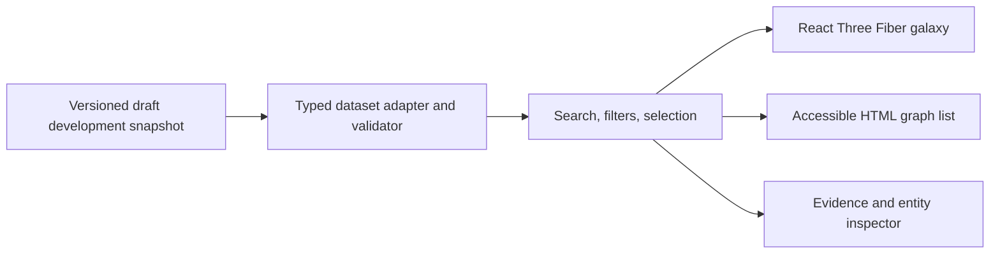
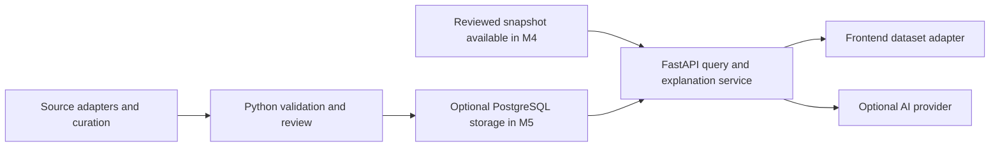

# Architecture

Status: M1 engineering is implemented as a local development preview. The starter's scientific records remain draft and await independent human review; there is no approved scientific release or deployment. See the [product scope](product.md), [build steps](../steps.md), and [starter data notes](../data/alzheimers/README.md).

## Current static explorer

The application uses React 19.3.0, TypeScript 5.9.3, Vite 8.3.2, Three.js 0.186.1, and React Three Fiber 9.8.1. Native Three.js `OrbitControls` provides camera navigation; Drei is not installed. The root npm workspace manages `apps/web/` with an exact-version lockfile, Node 24, and npm 11.9.0. See the [dependency security policy](npm-security.md) before installing or updating packages.

The client imports a versioned JSON development snapshot with eight entities: one disease, three genes, and four paper projections. Four source-scoped association claims link to evidence and original publications. The source lookup was AI-assisted and limited to abstracts and bibliographic records; it is not a completed human scientific review. All claims and evidence are draft, reuse review is pending, and correction/retraction checks remain incomplete.

Implemented views share React state for alias-aware search, entity-type filters, entity and claim selection, and evidence inspection. The scene is loaded lazily; original publication links, study context, limitations, and review status appear in the HTML inspector. The client requires no backend, database, live data API, or AI credential. Pathway content, disagreement comparisons, research-question cards, and live AI explanations remain planned.



The diagram shows the current application. The galaxy, list, and inspector are views of the same local records. A structural validation pass permits development use; it does not establish scientific validity. See the [data model](data-model.md) for schema `0.1.0` and the [evidence policy](evidence-policy.md) for publication rules.

## Component boundaries

| Boundary | Responsibility |
| --- | --- |
| Dataset adapter | Validate the imported snapshot and expose typed entities, claims, evidence, and sources. Invalid data produces a load-error state. |
| Search and graph helpers | Normalize aliases and identifiers; derive linked claims, paper citations, and filtered results without changing source records. |
| Explorer state | Own query, selected identifiers, active filters, and view mode; keep the canvas and HTML views synchronized. |
| Galaxy scene | Render nodes, edges, labels, camera focus, and visible selection state. Keep scientific logic outside render components. |
| Evidence inspector | Present the selected draft claim, source-linked notes, study context, limitations, original references, and review status. |

M2 expands the scientifically reviewed dataset to 20–50 entities and adds verified pathway content and richer filtering. M3 adds reviewed disagreement comparisons and research-question cards. Those additions must remain separate from evidence-backed claims and must not invent a consensus score.

At this size, local indexes and a bounded graph traversal are sufficient. A graph database, distributed processing, and microservices add little value before the exploration flow works. The adapter allows a future HTTP source to replace the local loader without coupling the UI to an upstream provider's response shape.

## Layout and interaction

The [design guide](design.md) is the standing interface standard. The interface uses a single control set above the explorer, a graph/list workspace, and a readable evidence panel. Light neutral interface surfaces frame the dark graph. Copy names actions and information directly. Observed browser results are recorded in the [verification record](verification.md).

- `createGalaxyLayout` derives deterministic positions from the full snapshot, preserving positions when the visible set changes. Position, size, glow, and decorative stars are navigation choices, not measurements of biological similarity, causality, or evidence strength.
- Solid connections project claims; dashed connections connect paper projections to the claims they cite. Citation links are not additional biological relationships.
- The HTML list, search results, and inspector provide entity and evidence selection without manipulating the canvas. The scene itself is hidden from the accessibility tree.
- The renderer uses demand-based frames, bounded pixel density, camera reset, and reduced-motion-aware controls. Hover, selection, camera focus, and zoom animate briefly and settle; materials and geometry are reused during feedback. User gestures interrupt camera transitions. Renderer errors and lost WebGL context switch to the list view.
- Filters expose their active state and support clearing. An absent edge in the curated or filtered graph says nothing about whether a relationship exists in the wider literature.

The graph/list/evidence flows and presentation refinements have browser coverage. Future refinements still need their own browser QA; do not infer their usability or smoothness from a passing build. Keyboard interaction, reduced-motion behavior, and fallback checks must be recorded separately from build and unit-test results.

## Data preparation

The current dataset is prepared manually and checked by the TypeScript validator used by both the client adapter and `tools/validate-data.ts`. Development validation checks structure, references, provenance fields, and claim/evidence consistency. Release validation additionally requires approved human reviews, reuse and publication-status checks, and the 20–50 entity release boundary. The current starter is intentionally blocked from release validation.

Introduce Python and NetworkX curation tooling in M2 for normalization, bounded graph inspection, and reproducible exports. The existing Python IOC checker is dependency-security tooling, not a scientific import pipeline. NetworkX connectivity will not establish a biological mechanism or validate a hypothesis.

Planned adapters for Open Targets, Reactome, and OpenAlex belong in this preparation boundary; none is implemented. Import only reviewed records into a published scientific snapshot. Preserve upstream identifiers, release information, retrieval dates, and applicable attribution and redistribution terms. Verify current upstream API access and licensing before implementing each adapter.

The client makes no upstream scientific API requests. The checked-in snapshot makes local exploration reproducible and independent of those services; opening an original external reference still requires network access.

## Later services, when needed



This is a later extension, not a prerequisite for the initial client. Add FastAPI when the application needs server-managed explanations, dynamic queries, or controlled refreshes; the optional M4 explanation service can read the reviewed snapshot without PostgreSQL. Add PostgreSQL when reviewed updates, record history, or query volume outgrow a static artifact. Store entities, claims, evidence, sources, and their provenance separately; relational joins are a reasonable starting point.

For optional AI, retrieve a bounded set of reviewed claim and evidence records on the server. Return citations that resolve to those supplied records. Explicitly separate evidence summaries from speculative questions and abstain when the available evidence cannot answer a request. Model output is not a new scientific source and must not silently alter the curated graph. Prompting alone does not guarantee factual accuracy: check citation references, evaluate grounding, and retain a curated-summary fallback.

Keep provider keys on the server, outside version control and client bundles. Add timeouts, request size limits, rate limits, and an explicit error state when this service exists. Core graph exploration must remain usable when explanations are unavailable.

## Repository layout

Current implementation paths:

```text
apps/web/             React app, scene, HTML views, adapter, validator, tests
data/alzheimers/       Draft development snapshot and source-lookup notes
data/schema/          Knowledge-graph JSON Schema
tools/validate-data.ts Development and release-mode data validation CLI
tools/security/       Lockfile policy, known-IOC checker, pinned feed manifest
```

`tools/curation/` and `services/api/` remain proposed paths for later scientific-data tooling and server requirements. No backend, PostgreSQL instance, or AI service exists. The checked-in dependency policy records a 14-day resolution cutoff; `.npmrc` disables installation lifecycle scripts, and the lockfile checker verifies source URLs, integrity hashes, and direct version pins. These controls reduce exposure without certifying dependencies as malware-free.

## Validation boundaries

Run the root project commands documented in [CONTRIBUTING.md](../CONTRIBUTING.md):

- `npm run validate:data` checks the development snapshot; warnings retain its pending-review status.
- `npm run validate:release` exercises the stricter publication gate and must fail for the current draft snapshot.
- `npm test` covers data-integrity and release-gate failures, alias search, and paper-to-claim lookup using isolated synthetic fixtures and the checked-in starter.
- `npm run build` runs TypeScript checks before creating the production bundle.
- `npm run check:dependencies` checks the lockfile's sources, integrity, and pins. Network-backed publication-date and pinned IOC checks are described in the [security policy](npm-security.md).

Browser QA must exercise search → entity → claim → original reference through both views, plus keyboard access, no results, reduced motion, and renderer fallback. Automated data tests do not verify those interactions. Measure responsiveness on a documented device/browser before setting or reporting a performance budget.

When AI is introduced, evaluate citation validity, claim grounding, abstention, hypothesis labeling, and service failure using reviewed answerable and unanswerable cases.

Keep tests proportional to real failure modes. Dataset provenance and the user's evidence-reading journey matter more than snapshotting decorative scene details.
